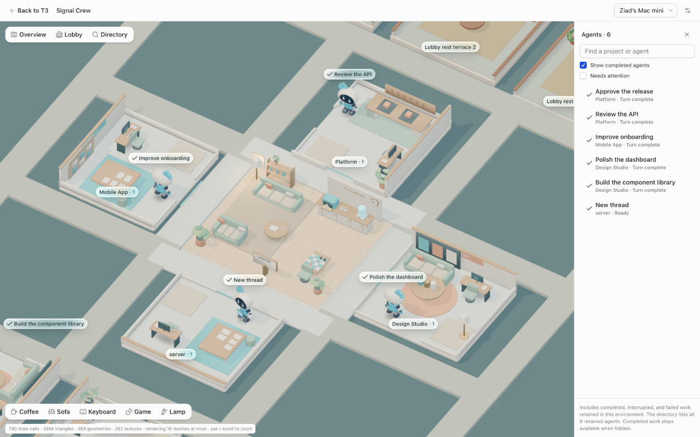
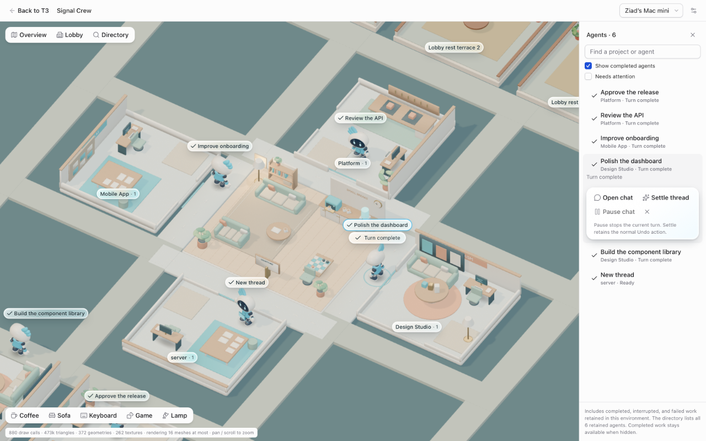
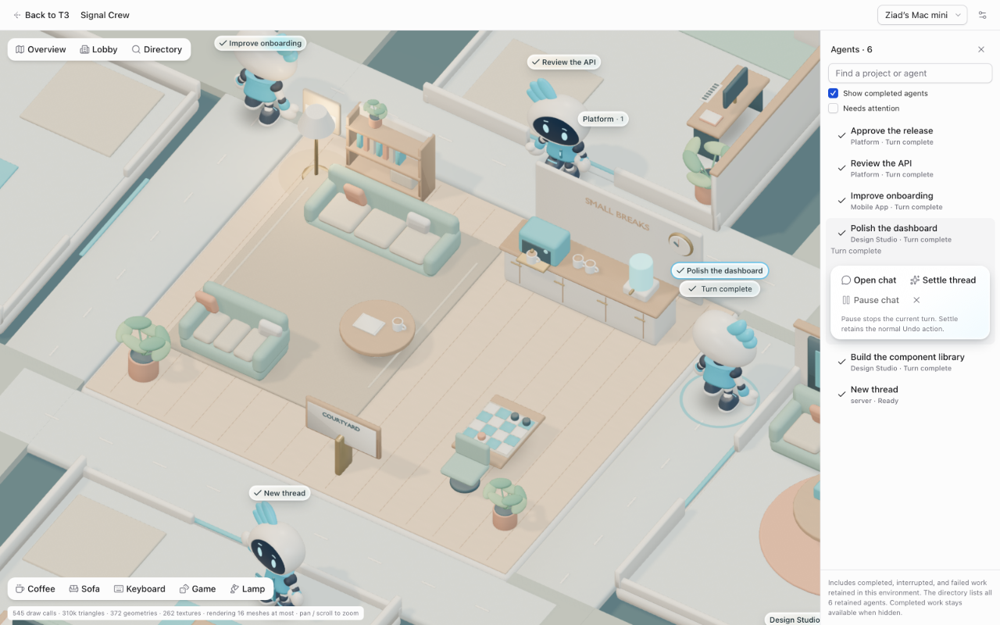

# Signal Crew Office

**Your coding agents. One living office.**

Turn parallel agent work into a place you can see. Signal Crew Office gives your
projects their own rooms and your agents a presence on an interactive 3D office
floor. See who's working, find the agent waiting for you, and open the conversation
right where the work is happening.



_Actual development-build captures with demo projects and replay agents. Completed
agents are shown to illustrate the floor; screenshots may include work ahead of
the published source._

Built on [T3 Code](https://github.com/pingdotgg/t3code), with its agent providers,
conversations, and remote connections underneath. This is
[Ziad-NasrEldin's independent fork](https://github.com/Ziad-NasrEldin/t3code);
credit for the original platform belongs to the upstream T3 Code team.

## Meet your crew

- **A room for every active project.** Explore a shared office floor, zoom into
  a project, or jump straight to an agent from the searchable directory.
- **Know who needs you.** Follow agent status and activity excerpts, and filter
  the directory to work that needs attention.
- **Go from overview to conversation.** Select an agent and open its chat inside
  Office. Pause a running turn or settle an eligible thread using T3 Code's
  existing controls and permissions.
- **Keep the floor focused.** Active work appears by default. Bring completed
  agents back into view when you want to revisit retained work.
- **Give the office some personality.** Send a selected agent for coffee, to the
  sofa, or to a game. These visits are playful animations; they never send a prompt
  or change the agent's task.
- **Set your own atmosphere.** Optional music, sound effects, activity bubbles,
  reduced motion, and a lower graphics load let you tune the experience.
- **Take your seat from another Mac.** Connect to the host environment through
  T3 Connect and follow the same work from an Office-enabled client.

### From the floor to the conversation

Select an agent to see its status and open its chat. Thread controls stay close
to the work, with availability based on the agent's state and your permissions.



### A little room to breathe

The shared lobby brings the crew together around sofas, coffee, and a game table.
Optional cosmetic visits add life to the office while agents keep their real tasks.



## Try Signal Crew Office

Office is under active development on `feat/signal-crew-office`.
Install [Vite+](#install-vp) and run:

```bash
git clone --branch feat/signal-crew-office https://github.com/Ziad-NasrEldin/t3code.git
cd t3code
vp i
vp run dev
```

Open the pairing URL printed by the dev runner, connect a provider, start a thread,
and open **Office**. For the Electron client, use `vp run dev:desktop` instead.
See [development setup](./docs/operations/development.md) for full instructions.

### Use Office from another Mac

Keep the machine hosting your agents awake and T3 Code running. In its desktop app,
open **Settings → Sharing & access**, sign in, and enable **T3 Connect**. On your
other Mac, use a build of this fork that includes Office, sign in to the same
T3 Connect account, select the host environment, and open **Office**.

Agents and project files stay on the host. Connecting another Mac does not copy
repositories or move running agents. To run agents on that Mac too, set it up as
its own environment with its own projects and authenticated providers.

See [remote access](./docs/user/remote-access.md) for pairing and connection options,
and [development setup](./docs/operations/development.md) to run this fork from source.
The installation commands and release links below install upstream T3 Code;
they do not install this fork's Office customizations.

## About T3 Code

T3 Code is an "agent harness control surface". It enables control of the agents on your machine with a best-in-class mobile app ([iOS](https://apps.apple.com/us/app/t3-code-remote-claude-more/id6787819824), [Android](https://play.google.com/store/apps/details?id=com.t3tools.t3code)), [web app](https://app.t3.codes) and [Electron-based desktop app](https://t3.codes).

Works with your subscriptions on Claude Code, Codex, Cursor, Grok Build, OpenCode, Google Antigravity, and fx. If they're set up on your computer, T3 Code can control them.

## "Wait, what are you selling me?"

Nothing. We built T3 Code because we wanted the best possible development experience with agents. We were inspired by existing solutions like the Codex desktop app, Conductor, Claude Desktop and Cursor Glass, but none met our bar.

We wanted something performant, remote-ready, and truly open. If we ever go the wrong direction, we want you to have everything you need to fork and build the editor that you want.

## Installation

> [!WARNING]
> T3 Code currently supports Codex, Claude, Cursor, Grok Build, OpenCode, Antigravity, and fx. Install and authenticate at least one provider before use:
>
> - Codex: install [Codex CLI](https://developers.openai.com/codex/cli) and run `codex login`
> - Claude: install [Claude Code](https://claude.com/product/claude-code) and run `claude auth login`
> - Cursor: install [Cursor CLI](https://cursor.com/cli) and run `agent login`
> - Grok Build: install [Grok Build CLI](https://x.ai/cli) and run `grok login`
> - OpenCode: install [OpenCode](https://opencode.ai) and run `opencode auth login`
> - Antigravity: enable it in Settings, then use **Install Antigravity** and **Sign in with Google**. No CLI is required.
> - fx: install [fx](https://fx.sh) and run `fx login` on the machine running the T3 Code server ([setup guide](./docs/user/providers-fx.md))

### Command line

```bash
curl -fsSL https://t3.codes/install.sh | sh
```

On Windows, in PowerShell:

```powershell
irm https://t3.codes/install.ps1 | iex
```

Then run `t3` to start the server and open the local web app. `t3 service install` keeps it running in the background, `t3 update` moves to a newer release, and `t3 --help` has the full reference.

To try it once without installing, run `npx t3@latest` instead.

### Desktop app

Install the latest version of the desktop app from [GitHub Releases](https://github.com/pingdotgg/t3code/releases), or from your favorite package registry:

#### Windows (`winget`)

```bash
winget install T3Tools.T3Code
```

#### Windows (`scoop`)

```bash
scoop install extras/t3code
```

#### macOS (Homebrew)

```bash
brew install --cask t3-code
```

#### Debian, Ubuntu (`.deb`)

Download the `.deb` from [GitHub Releases](https://github.com/pingdotgg/t3code/releases), then:

```bash
sudo apt install ./T3-Code-*.deb
```

#### Arch Linux (AUR)

Stable:

```bash
yay -S t3code-bin
```

Nightly:

```bash
yay -S t3code-nightly-bin
```

The AUR packaging is maintained in this repository under [`packaging/aur`](./packaging/aur).

#### Nix (nixpkgs)

```bash
nix profile add github:NixOS/nixpkgs/nixos-unstable#t3code
```

The package is maintained in [nixpkgs](https://github.com/NixOS/nixpkgs/tree/nixos-unstable/pkgs/by-name/t3/t3code)
and includes the desktop app (`t3code-desktop`) and the `t3` command.
See [Nix installation](./docs/user/install.md#nix-nixpkgs) for NixOS configuration and updates.

## Some notes

We are very very early in this project. Expect bugs.

We are (mostly) not accepting contributions yet. Small fixes may be considered. Big features will not be.

## Documentation

Full docs live in [docs/](./docs). There's no docs site yet.

- [FAQ](./docs/user/faq.md)
- [Install and first run](./docs/user/install.md)
- [Permission modes](./docs/user/permission-modes.md)
- [Keyboard shortcuts](./docs/user/keybindings.md)
- [Project settings](./docs/user/project-settings.md)
- [Appearance preferences](./docs/user/appearance.md)
- [Remote access from a phone or another machine](./docs/user/remote-access.md)
- [Connect Claude Code, Codex, ChatGPT and other agents over MCP](./docs/user/outside-agents.md)
- [Keeping app and server in sync](./docs/user/updating.md)
- [Source control integrations](./docs/user/source-control.md)
- Multiple accounts: [Codex](./docs/user/providers-codex.md) · [Claude](./docs/user/providers-claude.md)
- [Run T3 Code as a background service](./docs/user/background-service.md)

Building from source? Start at [docs/internals/overview.md](./docs/internals/overview.md).

## If you REALLY want to contribute still.... read this first

### Install `vp`

T3 Code uses Vite+ so you'll need to install the global `vp` command-line tool.

#### macOS / Linux

```bash
curl -fsSL https://vite.plus | bash
```

#### Windows

```bash
irm https://vite.plus/ps1 | iex
```

Checkout their getting started guide for more information: https://viteplus.dev/guide/

### Install dependencies

```bash
vp i
```

Read [CONTRIBUTING.md](./CONTRIBUTING.md) before reporting a bug or opening a PR.

Have a feature request? Start an [Ideas discussion](https://github.com/pingdotgg/t3code/discussions/categories/ideas).

Need support? Join the [Discord](https://discord.gg/jn4EGJjrvv).
